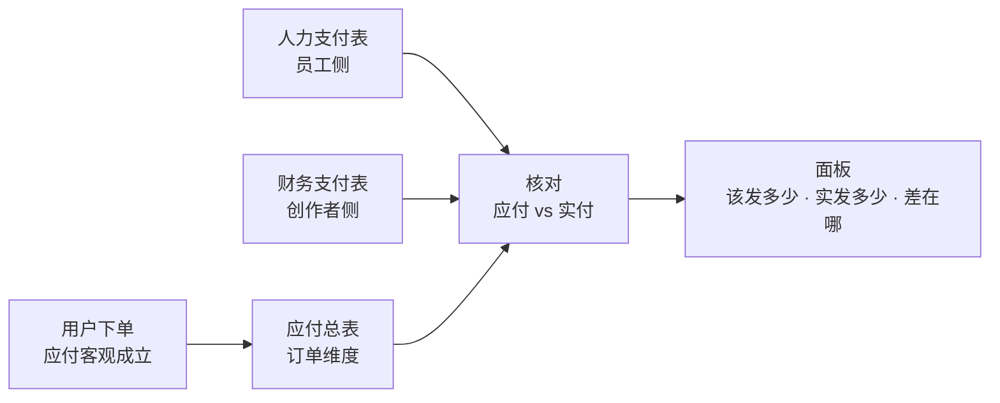
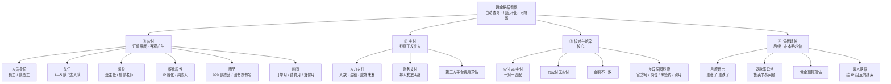
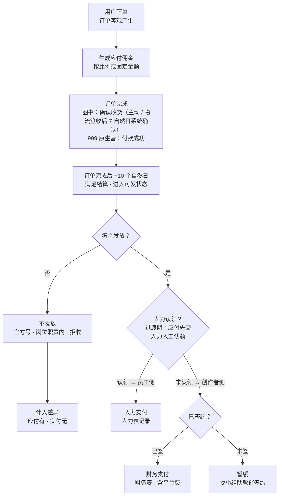
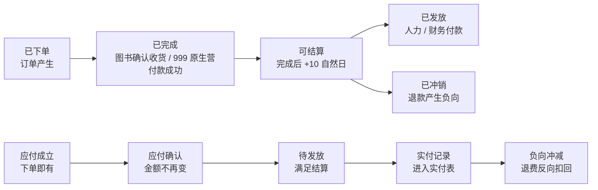
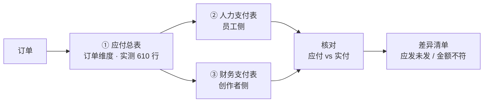
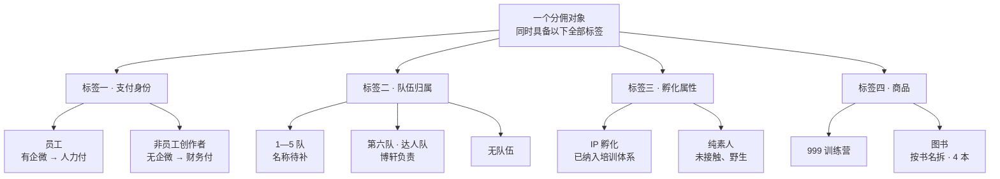
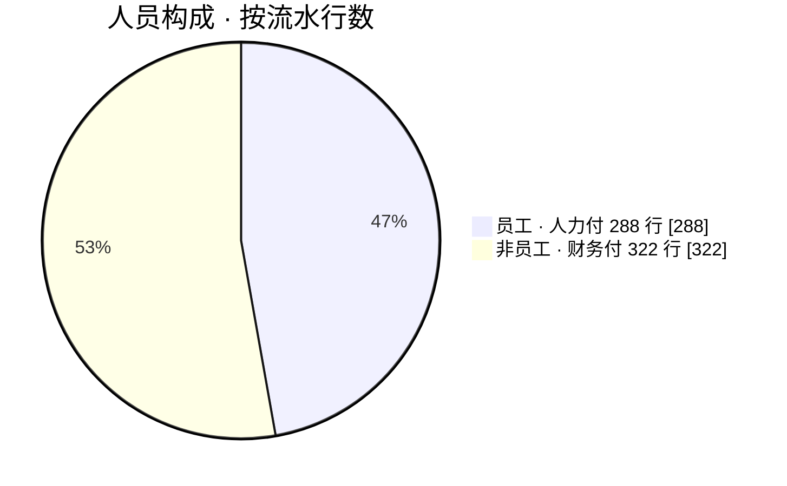
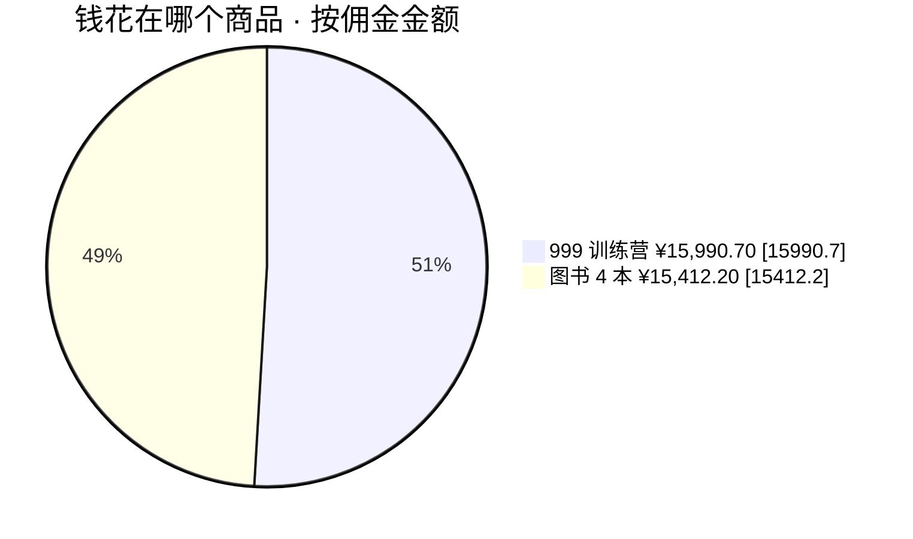
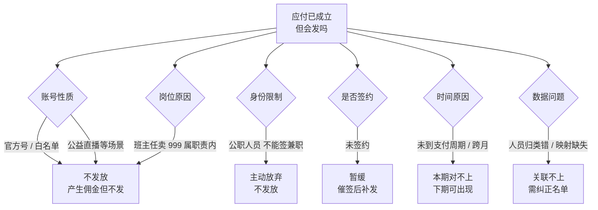

# 佣金数据看板 — 需求与业务逻辑说明

> 版本：v1.0（业务可读版） ｜ 日期：2026-10-22 ｜ 撰写依据：2026-10 两轮业务沟通录音转写 + 《2026年9月-满足结算.xlsx》实测（610 行）
> 本文只做**业务逻辑与数据关系的说明**，不设计新的业务规则。
> 凡文档未定义、未验证的内容，一律标注 `【待确认】`，不臆造公式、名单、支付日期。

---

## 0. 三十秒速读

**一句话**：把「订单产生的应付佣金」和「人力 / 财务实际付出的实付佣金」放进同一个可自助查询的面板，按人员、队伍、岗位、商品、月份多维交叉对比，让业务方一眼看出该发多少、实发多少、差在哪、为什么差。

### 六条关键结论

| # | 结论 | 说明 |
| - | --- | --- |
| 1 | **应付与实付同源**（10-22 更正） | 实付数据与应付基本一致，只多一列「这笔单子付没付」。先做支付标记，再做差额核对 |
| 2 | **支付通道：过渡期认领制**（10-22 更正） | 人力系统与后台打通前，应付先交人力人工认领订单，认领部分＝人力付；其余＝财务付 |
| 3 | **维度并列可交叉** | 员工/非员工、孵化/素人、队伍、岗位、商品是并列维度，**不是互斥分类** |
| 4 | **佣金有延后性**（10-22 更正） | 订单完成后 +10 个自然日才满足结算：图书看确认收货（主动确认，或物流签收后 7 个自然日系统确认），999 原生营付款成功即完成。订单月 ≠ 支付月 |
| 5 | **不发放有据可依** | 官方号/白名单、班主任 999、公职不签约等，造成「应付有、实付无」 |
| 6 | **要自助查询** | 不做每日推送，做成可筛选、可下钻、可导出的网页面板 |

**它解决什么**：过去每月要手工导表、按维度拆成十几张小表、再和上月对比，一份要花大半天；现在所有维度一键切换，应付实付并排显示。

**它不解决什么**：不自动判定「这笔该不该发」，不自动认定「差异是异常」，不替业务做发放决策。**工具只做统计与归类，不做判定。**

---

## 1. 需求全景：看板要回答的六个问题

按业务方原话归纳：先知道「该发多少」，再知道「实发了多少」，最后知道「差在哪、为什么」。

**读图**：看板内容分应付、实付、核对三大块，每块再拆到可查询的最小粒度。**③ 是核心，④ 是后续。**

| # | 看板要回答的问题 | 落在哪个板块 |
| - | --- | --- |
| 1 | 这个月该发多少 | ① 应付 · 总额 |
| 2 | 谁卖出来的（员工/非员工、哪队、什么岗） | ① 人员身份 |
| 3 | 卖的是什么（999 还是图书） | ① 商品 |
| 4 | 实发了多少、多少人、谁没发到 | ② 实付 |
| 5 | 差在哪、为什么差 | ③ 核对与差异 |
| 6 | 谁涨谁跌、下一步该找谁 | ④ 分析延伸 |

> 一条必须记住的结构关系：**「员工 / 非员工」与「孵化 / 素人」是两个并列维度**，各自都能覆盖全部人员；**队伍维度同时存在于员工与非员工身上**，不能只挂在员工下面。

---

## 2. 佣金从产生到发出的业务流程

**应付在订单产生那一刻就成立；实付要过「资格 + 签约 + 时间」三道关，这是两者不等的根因。**

**读图**：蓝色主链是应付，末端分叉是「不发」与「发」，发按过渡期认领制分两条通道（认领→人力、其余→财务，财务侧再看签约）。橙色菱形＝判断分支，红色＝终止不发。

| 项 | 内容 |
| --- | --- |
| **谁触发** | 用户下单（应付）；人力 / 财务按月付款（实付） |
| **依赖** | 订单完成 + 结算规则 + 发放资格 + 签约状态 |
| **产出** | 应付流水（正向 / 负向）+ 两张实付表 |
| **影响谁** | 业务方核对、负责人月度问询、IP 组反向挖掘 |

---

## 3. 订单与佣金的状态流转

**佣金状态滞后于订单状态，这就是为什么同一个月的订单和支付对不上。**

**读图**：上一条链是订单状态，下一条链是对应的佣金状态，中间的时间差就是差异来源之一。

| 订单状态 | 对应佣金状态 | 中间隔着什么 |
| --- | --- | --- |
| 已下单 | 应付成立 | 无，即时 |
| 已完成 | 应付确认 | 图书看确认收货（主动 / 物流签收后 7 自然日）；999 原生营付款成功即完成 |
| 可结算 | 待发放 | 订单完成后 +10 个自然日 |
| 已发放 | 实付记录 | 人力 / 财务的付款周期 |
| 已冲销 | 负向冲减 | 退款发生时间，可能跨月 |

> **三种月份口径并存**：订单月（下单）、结算月（满足结算）、支付月（实际打款）。**趋势图必须明确采用哪一种**，不能混着看。

---

## 4. 三张数据表的关系

### ① 应付总表（源头）

| 项 | 内容 |
| --- | --- |
| 谁触发 | 用户下单（系统自动生成） |
| 依赖 | 分佣规则、商品、人员身份 |
| 产出 | 每笔订单的应付佣金 |
| 影响谁 | 业务方汇总 → 人力 / 财务付款 |

### ② 人力支付表（员工侧）

| 项 | 内容 |
| --- | --- |
| 谁触发 | 人力部门按月付款 |
| 依赖 | 应付汇总 + 发放资格判定 |
| 产出 | 员工实付金额、应发未发名单 |
| 影响谁 | 员工本人、业务方核对 |

### ③ 财务支付表（创作者侧）

| 项 | 内容 |
| --- | --- |
| 谁触发 | 财务部门按月付款 |
| 依赖 | 应付汇总 + 创作者已签约 |
| 产出 | 每人发放明细 + 平台费用 |
| 影响谁 | 创作者本人、成本核算 |

> **实测发现**：应付总表 610 行的「结算时间」「结算单号」**全为空**——这张表只有应付、没有实付。所以三张表**必须分开建**，不能指望一张表算完。

---

## 5. 统计维度：并列、可交叉

**读图**：四个标签是并列关系，同一个人同时拥有全部四个，所以**每一层都能和另外三层交叉筛选**。

| 标签 | 取值 | 说明 |
| --- | --- | --- |
| **一、支付身份** | 员工（有企微 → 人力付） 非员工创作者（无企微 → 财务付） | 岗位上：班主任 999 属职责内，不额外发；启蒙老师、助教/督导/其他 `【待确认】` 完整名单 身份上：非员工分「已签约可发」「未签约暂缓」「公职人员无法签约不发」 |
| **二、队伍归属** | 1—5 队、第六队（达人队，博轩）、无队伍 | `【待确认】` 队名待补；**员工与非员工都可能有队伍** |
| **三、孵化属性** | IP 孵化（已纳入培训体系，含员工 + 非员工） 纯素人（未接触、野生） | `【待确认】` 名单由一心 / 冠鹏 / 博轩提供 |
| **四、商品** | 999 训练营、图书（按书名拆，4 本） | `【待确认】` 口述「3—4 本」与「5 个商品名」不一致 |

> **两条等式**：员工 + 非员工 = 全部人；IP 孵化 + 纯素人 = 全部人。所以页面上这两个维度是**十字交叉**，不是互斥单选。

---

## 6. 构成与优先级

三张图均用 9 月应付样本实测值（610 行），非估算。

**说明**：创作者侧流水条数已过半，两块支付量级相当，**两条实付数据都不能缺**。

**说明**：两类商品金额几乎对半，但图书订单量远大于训练营（500 vs 110 行），单价差异大，**必须分开看**。

| 正向 vs 冲减 | 行数 | 金额 |
| --- | --- | --- |
| 正向流水 | 581 行 | ¥33,036.30 |
| 负向冲减 | 29 行 | −¥1,633.40 |
| **净额** | 610 行 | **¥31,402.90** |

**说明**：29 条负向流水 **100% 可回指原正向流水**，配对完整，可用于定位「卖了又退」的订单与人，**不存在重复扣减**。

---

## 7. 角色与数据对应关系

| 角色 | 触发的动作 | 依赖什么 | 产出什么 | 影响谁 |
| --- | --- | --- | --- | --- |
| **用户** | 下单 / 退款 | 商品、分佣规则 | 订单 + 应付流水（正向 / 负向） | 创作者、员工、应付总表 |
| **创作者** | 售卖、签约、拒签 | 小组助教联系路径 | 签约状态 | 能否进入财务发放 |
| **员工** | 售卖（岗位行为） | 企微身份、岗位 | 应付流水 | 人力发放资格判定 |
| **小组助教** | 协助联系未签约创作者 | 后台用户管理中的创作者信息 | 签约推进结果 | 财务当月能否发放 |
| **人力部门** | 给员工付款 | 应付汇总 + 发放资格 | 人力支付表 | 员工实付、差异核对 |
| **财务部门** | 给创作者付款 | 应付汇总 + 签约状态 | 财务支付表（含平台费） | 创作者实付、成本核算 |
| **业务方（需求方）** | 月度汇总、核对、催签 | 三张表 + 纠正名单 | 佣金面板、月度汇报 | 负责人、IP 组、预算 |
| **IP 组**（一心 / 冠鹏 / 博轩） | 维护孵化名单、12 月 100 个 IP 目标 | 面板中的素人线索 | 孵化名单 | 看板「孵化 / 素人」维度 |
| **数据 / 开发** | 搭接口与页面 | 三张表字段与关联键 | 可视化面板 | 业务方自助查询 |

**读表**：横向看每一行就是一条链路——**谁动手 → 靠什么 → 留下什么 → 卡住谁**。

---

## 8. 不发放的判定分支

**读图**：六类分支最终都表现为「应付有、实付无」，但**原因完全不同**——所以差异清单必须能按原因分组，不能一锅端。

| 类别 | 具体情形 | 结果 |
| --- | --- | --- |
| **账号性质** | 官方号 / 白名单、公益直播等场景 | 产生佣金但不发放 |
| **岗位原因** | 班主任卖 999 属职责内，部门已给过业绩 | 不额外发 |
| **身份限制** | 公职人员不能签兼职合同，主动放弃 | 不发放 |
| **创作者未签约** | 需催签后补发 | 暂缓 |
| **时间原因** | 未到支付周期（订单完成后 +10 自然日）、跨月发放 | 本期对不上，下月出现 |
| **数据问题** | 人员归类错误、映射缺失 | 无法关联人员 / 商品 |

> ⚠️ **这些是「要考虑的场景」，不是「已具备的自动识别能力」。** 页面对差异只做归类提示，**不自动定性为异常**；判定规则与优先级全部 `【待确认】`。

---

## 9. 待确认问题

### A · 人员与组织

| # | 待确认 |
| - | --- |
| A1 | **6 个队的正式名称与编号**：已知 1—5 队 + 达人队（博轩），中间是否有其他名称；后台字段实测出现 **11 个部门值**，如何映射 |
| A2 | **非员工是否也归队**：口述「非员工也可能属于某队」，但队伍名单由谁维护、是否覆盖纯素人 |
| A3 | **岗位完整分类**：班主任、启蒙老师之外还有哪些；岗位与部门字段是否同一来源 |
| A4 | **IP 孵化名单来源**：由一心 / 冠鹏 / 博轩提供？IP 工作台后续是否自动同步？当前网站上看不到该名单 |
| A5 | **孵化名单是否含员工**：口述「IP 孵化里混杂员工与创作者」，名单需标注身份 |
| A6 | **公职人员识别方式**：靠什么字段或名单判断「不签约、不发放」 |
| A7 | **小组助教关联规则**：默认创作者都是 7 万课会员因而有助教，但存在活动放开的例外，例外如何处理 |

### B · 规则与口径

| # | 待确认 |
| - | --- |
| B1 | **班主任 999 不额外发放**：判定字段是什么？是否覆盖全部 999 订单？是否同样适用于其他岗位 |
| B2 | **白名单 / 官方号清单**：后台白名单功能不完善，当前清单从哪来、由谁维护、如何更新 |
| B3 | **不发放场景是否还有其它**：口述提到「公益直播等」，完整清单待补 |
| B4 | **图书 4 本 vs 5 个商品名**：口述前后提到 3—4 本书、5 个商品名，以哪个为准 |
| B5 | ~~+10 个工作日规则~~ → **已更正（10-22）**：订单完成后 +10 个自然日，统一适用；图书完成口径＝确认收货（主动 / 物流签收后 7 自然日系统确认），999 原生营付款成功即完成 |
| B6 | **三种月份口径**：环比与趋势用订单月、结算月还是支付月；退款金额归属哪个月 |
| B7 | **6.8% 平台费用**：是税费还是手续费？计算基数是什么？是否仅财务侧？是否计入本看板成本 |

### C · 数据与系统

| # | 待确认 |
| - | --- |
| C1 | **人力表与财务表的字段清单**：是否含人员 ID、手机号、订单号；决定能否关联到订单级 |
| C2 | **实付能否关联具体订单**：应付表结算时间、结算单号全为空，实付侧是否提供批次或单号 |
| C3 | **签约状态字段来源**：哪个系统可取，多久更新一次 |
| C4 | **「归类有问题的老师」纠正数据**：格式、提供频率、如何回写 |
| C5 | **数据更新频率**：月度还是实时；面板刷新机制 |
| C6 | **导出范围与权限**：含身份证号等敏感字段是否脱敏 |
| C7 | **历史数据范围**：目前确认有 7、8、9 月；另有 4、5 月数据是否纳入首期 |

### D · 需求边界

| # | 待确认 |
| - | --- |
| D1 | **本期范围**：预算预估、手续费预估入口是否放进第一版 |
| D2 | **AI 分析期望**：口述希望 AI 自动发现退款率异常、售卖节奏问题，是否本期实现 |
| D3 | **与 IP 组目标的关系**：素人挖掘是本期还是后续，是否需负责人确认后再加 |
| D4 | **呈现形式**：明确为自助查询网页，不做每日推送；是否支持导出与筛选组合 |
| D5 | **是否需要同比**：口述只要环比，未来是否加同比 |

---

## 10. 名词解释

| 名词 | 意思 |
| --- | --- |
| **应付佣金** | 订单一旦产生就客观存在的佣金，不管最后发不发 |
| **实付佣金** | 人力 / 财务实际打出去的钱，次月才有 |
| **满足结算** | 应付明细的入口状态，意思是「这笔已经到该算钱的阶段」 |
| **正向 / 负向流水** | 正向＝出的订单；负向＝退款冲回，带原订单 ID |
| **订单月 / 结算月 / 支付月** | 分别看：哪张单产生的、哪天满足结算、哪个月真打款 |
| **人力通道 / 财务通道** | 有企微走人力，没企微走财务；这是**支付方式**决定的，不是身份 |
| **IP 孵化 / 纯素人** | 已纳入培训体系 / 完全野生，两者相加是全部人 |
| **达人队** | 第六队，博轩负责，属于创作者侧 |
| **白名单** | 允许发放的账号清单（官方号等），功能尚不完善 |
| **小组助教** | 联系创作者的现有路径，用于催签约 |
| **下钻** | 从汇总数字点进去看具体的订单和人 |

---

## 附录 A：写进开发的硬约束

1. **应付与实付分开存、分开算**，不合并成一个「佣金总额」字段。
2. **占比分母必须与指标对应**，应付的占比不拿实付做分母，反之亦然。
3. **月份口径必须显式**，任何页面 / 接口都带口径参数（订单月 / 结算月 / 支付月），不设隐式默认。
4. **未确认的规则一律不计算**：不算退款率、不推支付日期、不套 6.8%。结算时点规则已确认（订单完成后 +10 自然日），但缺确认收货 / 签收时间字段，预计支付日期只能按订单时间粗估。
5. **差异只归类不定性**，输出「应发未发 / 金额不符 / 未签约 / 时间错位 / 映射缺失」，不输出「异常」。
6. **关联不确定 → 挂起**，不猜、不兜底、不做模糊匹配写库。
7. **负向流水保留回指 ID**，用于定位原订单，不做合并去重。
