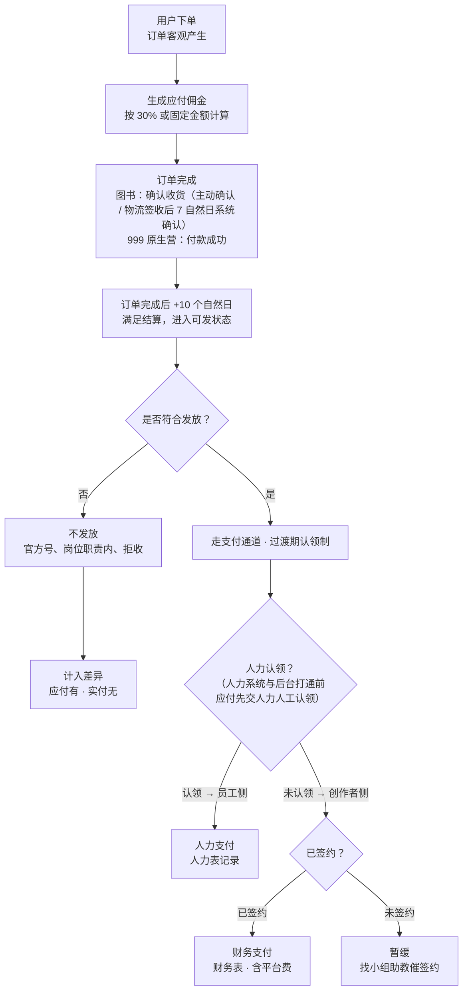
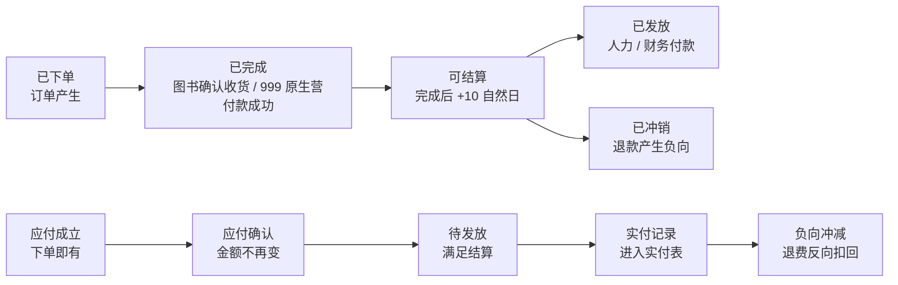
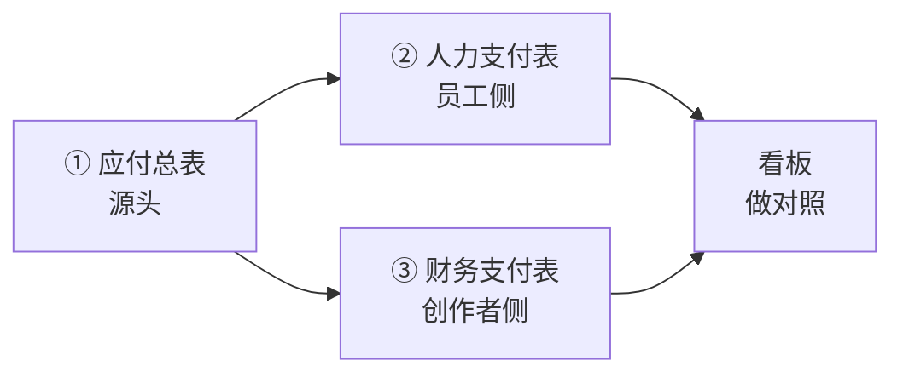
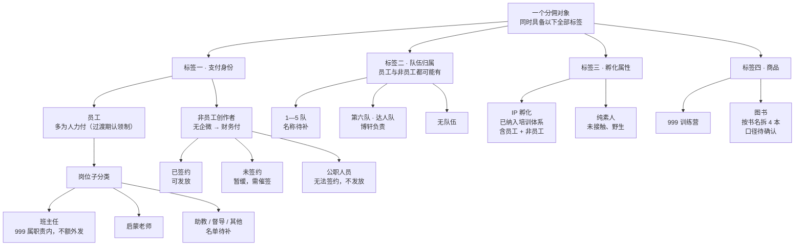
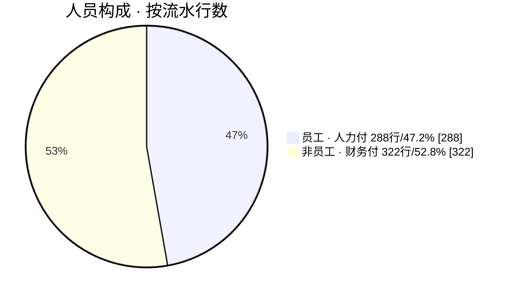
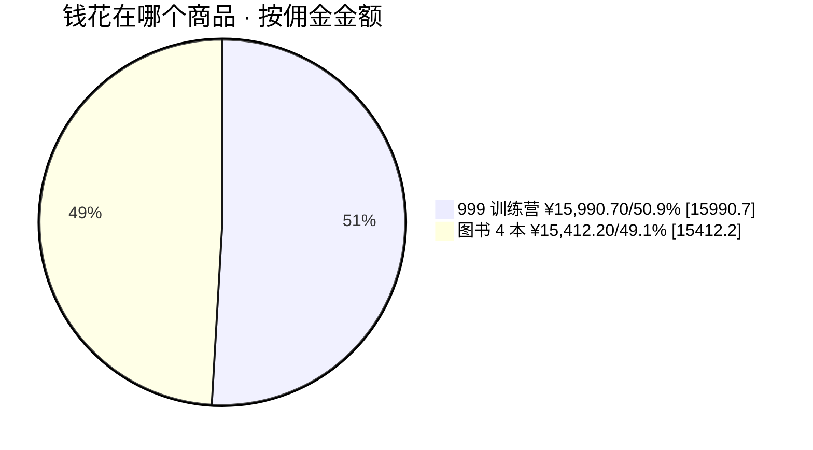
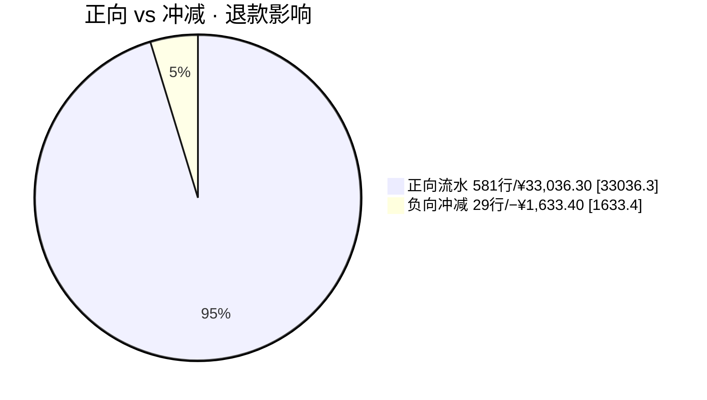
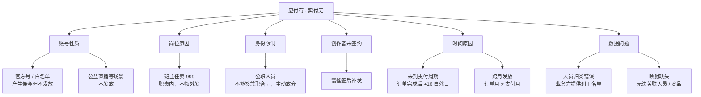

# 佣金数据看板 · 需求与业务逻辑说明

> 基于三轮业务沟通整理（2026-10-22 订单中台韩浩旭补充口径，标注为「更正」）

**核心目标**：把「订单产生的应付佣金」与「人力 / 财务实际付出的实付佣金」放在同一个可自助查询的面板里，按人员、队伍、岗位、商品、月份多维交叉对比，让业务方一眼看出该发多少、实发多少、差在哪、为什么差。

| 结论 | 内容 |
| --- | --- |
| **应付与实付同源**（更正） | 实付数据与应付基本一致，只多一列「这笔单子付没付」。看板先做同一张表的支付标记，再做差额核对。 |
| **支付通道：过渡期认领制**（更正） | 人力系统与后台打通前，应付先交人力人工认领订单，认领部分＝人力付；其余＝财务付。不再按「有无企微」自动判定。 |
| **维度并列可交叉** | 员工/非员工、孵化/素人、队伍、岗位、商品是并列维度，不是互斥分类。 |
| **佣金有延后性**（更正） | 订单完成后 +10 个自然日才满足结算：图书看确认收货（主动确认，或物流签收后 7 个自然日系统确认），999 原生营付款成功即完成。订单月 ≠ 支付月。 |
| **不发放有据可依** | 官方号/白名单、班主任 999、公职不签约等会造成应付有、实付无。 |
| **要自助查询** | 不做每日推送，做成可筛选、可下钻、可导出的网页面板。 |

---

## 1. 需求全景：看板要回答的六个问题

按业务方原话归纳：先知道「该发多少」，再知道「实发了多少」，最后知道「差在哪、为什么」。

> 树状图：看板内容分成应付、实付、核对三大块，每块再拆到可查询的最小粒度。

```mermaid
flowchart TD
    ROOT["佣金数据看板<br/>自助查询 · 月度环比 · 可导出"]
    ROOT --> A["① 应付<br/>订单维度，客观产生"]
    ROOT --> B["② 实付<br/>钱真正发出去"]
    ROOT --> C["③ 核对与差异<br/>核心"]
    ROOT --> D["④ 分析延伸<br/>后续，非本期必做"]
    A --> A1["人员身份"]
    A1 --> A1a["员工<br/>有企微"]
    A1a --> A1a1["按队伍：1—5 队"]
    A1a --> A1a2["按岗位：班主任 / 启蒙老师 / …"]
    A1 --> A1b["非员工创作者<br/>无企微"]
    A1b --> A1b1["按队伍：含达人队"]
    A1b --> A1b2["签约 / 未签约"]
    A --> A2["孵化属性"]
    A2 --> A2a["IP 孵化<br/>已纳入培训"]
    A2 --> A2b["纯素人<br/>未接触"]
    A --> A3["商品"]
    A3 --> A3a["999 训练营"]
    A3 --> A3b["图书<br/>按书名拆分"]
    A --> A4["时间"]
    A4 --> A4a["订单月 / 结算月 / 支付月"]
    B --> B1["人力支付 · 认领订单"]
    B1 --> B1a["实付人数 / 金额"]
    B1 --> B1b["应发未发人员"]
    B1 --> B1c["拆商品"]
    B --> B2["财务支付 · 其余订单"]
    B2 --> B2a["发放明细：每人多少"]
    B2 --> B2b["第三方平台费用预估"]
    B2 --> B2c["拆商品"]
    C --> C1["应付 vs 实付"]
    C1 --> C1a["一对一匹配"]
    C1 --> C1b["有应付无实付"]
    C1 --> C1c["金额不一致"]
    C --> C2["差异原因线索"]
    C2 --> C2a["官方号 / 白名单"]
    C2 --> C2b["岗位本身不发"]
    C2 --> C2c["未签约 / 拒收"]
    C2 --> C2d["跨月时间差"]
    D --> D1["月度环比：谁涨了、谁跌了"]
    D --> D2["退款率异常：售卖节奏问题"]
    D --> D3["佣金预算预估"]
    D --> D4["素人挖掘：给 IP 组反向线索"]
    D --> D5["提醒签约：未签约名单推给助教"]
```

> 「员工 / 非员工」与「孵化 / 素人」是两个并列维度，各自都能覆盖全部人员；队伍维度同时存在于员工与非员工身上。

---

## 2. 佣金从产生到发出的业务流程

应付在订单产生那一刻就成立；实付要过「资格 + 签约 + 时间」三道关，这是两者不等的根因。

> 流程图：蓝色＝应付链路，绿色＝实付链路，橙色菱形＝判断分支，红色＝终止不发。

> 触发方：用户下单（应付）；业务方汇总（实付）。依赖：订单完成 + 结算规则 + 签约状态。产出：两张实付表。影响：业务方核对、海岩老师月度问询、IP 组反向挖掘。

---

## 3. 订单与佣金的状态流转

佣金状态滞后于订单状态，这就是为什么同一个月的订单和支付对不上。

> 状态流转图：上行是订单状态，下行是对应的佣金状态，中间的时间差即差异来源之一。

> 三种月份口径并存：订单月（下单）、结算月（满足结算）、支付月（实际打款）。趋势图必须明确采用哪一种。

---

## 4. 三张数据表的关系

一张应付总表 + 两张实付表。三者靠「人」关联，靠「金额」核对；能否关联到订单取决于实付表字段。

> 关系图：应付总表是源头，人力表与财务表是结果，看板做对照。

### ① 应付总表 ｜ 源头

订单级分佣流水，含正负向

| 项 | 内容 |
| --- | --- |
| 谁触发 | 用户下单（系统自动生成） |
| 依赖 | 分佣规则、商品、人员身份 |
| 产出 | 每笔订单的应付佣金 |
| 影响谁 | 业务方汇总 → 人力 / 财务付款 |

### ② 人力支付表 ｜ 员工侧

过渡期由人力从应付中人工认领订单后发放（人力系统与后台打通中）

| 项 | 内容 |
| --- | --- |
| 谁触发 | 人力部门认领订单并按月付款 |
| 依赖 | 应付汇总 + 发放资格判定 |
| 产出 | 员工实付金额、应发未发名单 |
| 影响谁 | 员工本人、业务方核对 |

### ③ 财务支付表 ｜ 创作者侧

人力未认领的其余订单，由财务经三方平台发放

| 项 | 内容 |
| --- | --- |
| 谁触发 | 财务部门按月付款 |
| 依赖 | 应付汇总 + 创作者已签约 |
| 产出 | 每人发放明细 + 平台费用 |
| 影响谁 | 创作者本人、成本核算 |

> 已知可用字段（9 月样本实测）：人员＝用户ID / 手机号（610/610 全覆盖）、实名；订单＝来源单据ID；商品＝商品ID。未知：人力表与财务表是否含这些字段 —— 决定能否下钻到订单级。

---

## 5. 统计维度：并列、可交叉

业务方明确：这些维度不是互斥分类，任何人同时拥有多个标签，看板要能任意组合筛选。

> 树状图：人员身上同时挂着「支付方式 / 队伍 / 岗位 / 孵化属性」四类标签；商品与时间独立。

> 两条等式（业务方原话）：员工 + 非员工 ＝ 全部人员；IP 孵化 + 纯素人 ＝ 全部人员。因此这两个维度是十字交叉，不能做成单一分类下拉。

---

## 6. 构成与优先级

两张饼图均用 9 月应付样本实测值（610 行），非估算。

### 人员构成 ｜ 按流水行数

> 说明：创作者侧流水条数已过半，两块支付量级相当，两条实付数据都不能缺。

### 钱花在哪个商品 ｜ 按佣金金额

> 说明：两类商品金额几乎对半，但图书订单量远大于训练营（500 vs 110 行），单价差异大，需分开看。

### 正向 vs 冲减 ｜ 退款影响

> 说明：29 条负向流水 100% 可回指原正向流水，配对完整，可用于定位「卖了又退」的订单与人。

---

## 7. 角色与数据对应关系

谁触发动作、依赖什么数据、产出什么、最终影响谁 —— 一张表对齐。

| 角色 | 触发的动作 | 依赖什么 | 产出什么 | 影响谁 |
| --- | --- | --- | --- | --- |
| 用户 | 下单 / 退款 | 商品、分佣规则 | 订单 + 应付流水（正向 / 负向） | 创作者、员工、应付总表 |
| 创作者 | 售卖、签约、拒签 | 小组助教联系路径 | 签约状态 | 能否进入财务发放 |
| 员工 | 售卖（岗位行为） | 企微身份、岗位 | 应付流水 | 人力发放资格判定 |
| 小组助教 | 协助联系未签约创作者 | 后台用户管理中的创作者信息 | 签约推进结果 | 财务当月能否发放 |
| 人力部门 | 给员工付款 | 应付汇总 + 发放资格 | 人力支付表 | 员工实付、差异核对 |
| 财务部门 | 给创作者付款 | 应付汇总 + 签约状态 | 财务支付表（含平台费） | 创作者实付、成本核算 |
| 业务方（需求方） | 月度汇总、核对、催签 | 三张表 + 纠正名单 | 佣金面板、月度汇报 | 海岩老师、IP 组、预算 |
| IP 组（一心 / 冠鹏 / 博轩） | 维护孵化名单、12 月 100 个 IP 目标 | 面板中的素人线索 | 孵化名单 | 看板「孵化 / 素人」维度 |
| 数据 / 开发 | 搭接口与页面 | 三张表字段与关联键 | 可视化面板 | 业务方自助查询 |

> 「归类有问题的老师」纠正数据由业务方提供，用于修正人员身份归属，会直接影响员工 / 非员工的划分与支付通道归属。

---

## 8. 不发放的判定分支

这些是造成「应付有、实付无」的具体情形，来自业务方口述，判定条件尚需逐条书面确认。

> 分支图：每一类情形对应一种差异表现，看板只提示线索，不自动定性为异常。

**另有两类差异形态：**

- **金额不一致** —— 人对上了但金额不同 —— 退款冲减、平台费用、比例调整、多笔合并支付。
- **有实付无应付** —— 发了钱但应付表找不到 —— 跨期补发、归类错误。

---

## 8.5 特殊场景：发放角色切换（韩浩旭 2026-09-09 口径）

人的员工 / 创作者身份在月中可能切换，佣金按「对应行为发生时的身份」分段结算。

| 场景 | 规则 |
| --- | --- |
| 前半月为员工，后续离职，次月参与分佣 | 在职期间：按工资结算发放；离职之后：按创作者规则结算发放 |
| 前半月为创作者，后续入职成为员工，次月参与分佣 | 暂无此类情况；先在流水上记录发放角色，待发放时再确认具体方式 |

> 面板实现：流水上保留「发放角色」字段，切换月的人员分段展示。

---

## 9. 待确认问题

原文存在歧义、冲突或信息缺失的条目，需业务方逐条书面确认后进入开发。

### A · 人员与组织

- 6 个队的正式名称与编号：已知 1—5 队 + 达人队（博轩），中间是否有其他名称；后台字段实测出现 11 个部门值，如何映射。
- 非员工是否也归队：口述「非员工也可能属于某队」，但队伍名单由谁维护、是否覆盖纯素人。
- 岗位完整分类：班主任、启蒙老师之外还有哪些；岗位与部门字段是否同一个来源。
- IP 孵化名单来源：由一心 / 冠鹏 / 博轩提供？IP 工作台后续是否自动同步？当前网站上看不到该名单。
- 孵化名单是否含员工：口述「IP 孵化里混杂员工与创作者」，名单需标注身份。
- 公职人员识别方式：靠什么字段或名单判断「不签约、不发放」。
- 小组助教关联规则：默认创作者都是 7 万课会员因而有助教，但存在活动放开的例外，例外如何处理。

### B · 规则与口径

> 2026-10-22 更正后已解决：结算周期（订单完成后 +10 个自然日，统一适用）、订单完成口径（图书确认收货 / 999 原生营付款成功）、发放角色切换特殊场景（见第 8.5 节）。

- 班主任 999 不额外发放：判定字段是什么？是否覆盖全部 999 订单？是否同样适用于其他岗位。
- 白名单 / 官方号清单：后台白名单功能不完善，当前清单从哪来、由谁维护、如何更新。
- 不发放场景是否还有其它：口述提到「公益直播等」，完整清单待补。
- 图书 4 本 vs 5 个商品名：口述前后提到 3—4 本书、5 个商品名，以哪个为准。
- 三种月份口径：环比与趋势用订单月、结算月还是支付月；退款金额归属哪个月。
- 6.8% 平台费用：是税费还是手续费？计算基数是什么？是否仅财务侧？是否计入本看板成本。

### C · 数据与系统

- 人力表与财务表的字段清单：是否含人员 ID、手机号、订单号；决定能否关联到订单级。
- 实付能否关联具体订单：应付表结算时间、结算单号全为空，实付侧是否提供批次或单号。
- 签约状态字段来源：哪个系统可取，多久更新一次。
- 「归类有问题的老师」纠正数据：格式、提供频率、如何回写。
- 数据更新频率：月度还是实时；面板刷新机制。
- 导出范围与权限：含身份证号等敏感字段是否脱敏。
- 历史数据范围：目前确认有 7、8、9 月；另有 4、5 月数据是否纳入首期。

### D · 需求边界

- 本期范围：预算预估、手续费预估入口是否放进第一版。
- AI 分析期望：口述希望 AI 自动发现退款率异常、售卖节奏问题，是否本期实现。
- 呈现形式：明确为自助查询网页，不做每日推送；是否支持导出与筛选组合。
- 是否需要同比：口述只要环比，未来是否加同比。
- 优先级归属：作为个人工作需求按正常排期，是否需要于老师确认。

> 已解决：素人挖掘为后续延伸（非本期必做）；2026-10-22 追加「提醒签约」块。

---

> 整理自三轮业务沟通（两轮录音转写 + 2026-10-22 韩浩旭群内口径更正）；涉及 9 月样本的数字均来自《2026年9月-满足结算.xlsx》实际统计，其余为定性描述，未做估算。
> 凡标注「待确认」处均为原文存在歧义或信息缺失，需业务方补充后确认。
